# 꿈꾸는좋은교회 홈페이지 관리 안내

주보를 쓰고, 홈페이지 소식·영상을 올리는 분들을 위한 안내입니다.
이 안내의 화면은 연습용 샘플 자료로 찍은 것이라, 실제 화면의 내용과 다를 수 있습니다.
로그인한 뒤 관리 화면 맨 아래의 **사용 안내**를 누르면 언제든 이 안내를 새 탭으로 볼 수 있습니다.

- 관리자 주소: **[https://towbchurch.com/admin](https://towbchurch.com/admin)**
- 컴퓨터(크롬·엣지)에서 쓰는 것을 권합니다. 휴대폰에서도 열리지만 화면이 좁습니다.

## 1. 로그인

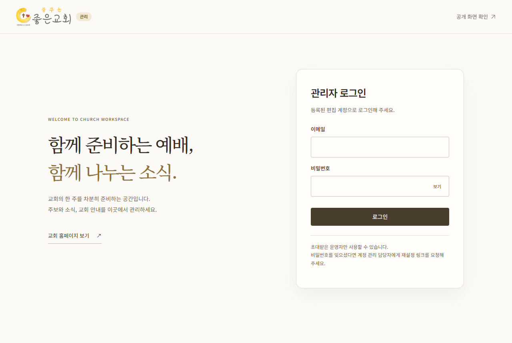

초대 메일(링크)로 처음 비밀번호를 정한 뒤, 이메일과 비밀번호로 로그인합니다.
비밀번호를 잊으셨다면 관리 담당자에게 재설정 링크를 요청해 주세요.

로그인하면 위쪽에 네 가지 메뉴가 있습니다.

| 메뉴 | 하는 일 |
| --- | --- |
| 주보 관리 | 매주 주보 작성·게시·예약 공개, 인쇄용 PDF·Word 내려받기, 특별 순서지 게시 |
| 공지·일정 관리 | 홈페이지 '교회 소식'의 공지와 일정 |
| 예배 영상 관리 | 홈페이지 예배 영상 등록, 찬양 곡 목록 보기 |
| 홈페이지 관리 | 홈 화면 문구, 교회 소개(인사말·오시는 길·예배시간·헌금 안내), 사진 |

오른쪽 위 **공개 화면 확인**을 누르면 성도들이 보는 홈페이지가 새 창으로 열립니다.
화면 맨 아래에는 **사용 안내**와 **로그아웃**이 있습니다.

> **뒤로가기와 새로고침**
> 브라우저의 뒤로가기를 누르면 한 화면씩 돌아갑니다(주보 상세 → 주보 목록).
> 새로고침하거나 주소를 복사해 보내도 보던 주보·소식·영상·곡이 그대로 열립니다.

## 2. 매주 주보 만들기

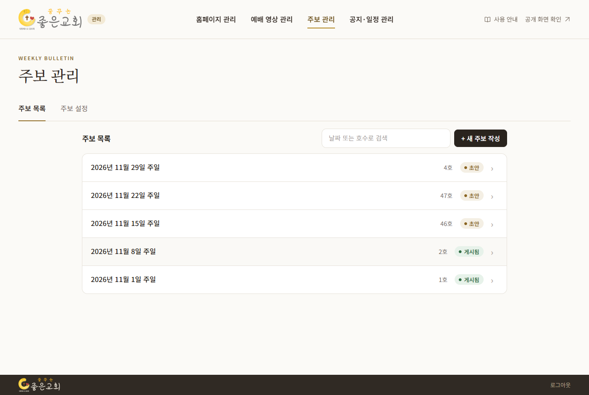

주보 목록에는 날짜 순으로 주보가 보이고, 오른쪽에 상태가 표시됩니다.

| 상태 | 뜻 |
| --- | --- |
| 초안 | 아직 공개되지 않았습니다. 고치거나 지울 수 있습니다. |
| 예약 · 날짜 시각 | 그 시각이 되면 저절로 공개됩니다. |
| 게시됨 | 홈페이지 '주보'에 보이고 있습니다. |

### ① 새 주보 시작하기

1. **주보 관리**에서 **+ 새 주보 작성**을 누릅니다. 날짜는 다음 주일, 호수는 다음 번호로 자동으로 들어갑니다.
2. 오른쪽의 **지난 주 가져오기**를 누르면 지난주 주보 내용을 그대로 가져옵니다. 바뀐 곳만 고치면 됩니다.

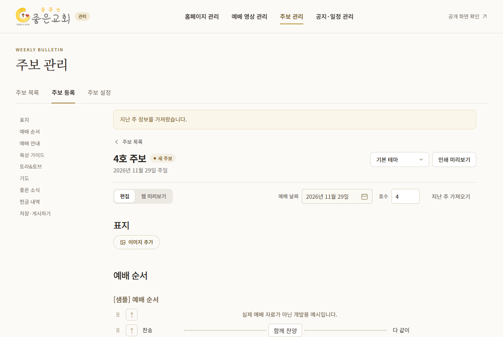

> **날짜에 따라 자동으로 바뀌는 것**
> - **첫째·셋째 주일**에는 '좋은 소식 · 예배' 칸 맨 위에 `1시 오후 찬양예배 / 본문 : ... / 제목 : ...`이 들어갑니다. `...` 자리에 본문과 제목을 채워 주세요. 다른 주에는 자동으로 빠지고, 오후예배가 없는 주라면 이 줄을 지우면 됩니다.
> - **매월 첫 주일**에는 '헌금 내역'이 켜지고 집계 월이 지난달로 맞춰집니다(금액은 비어 있음). 다른 주에는 꺼집니다.
> - '다음 주 봉사위원' 날짜, '기도·안내' 날짜도 그 주에 맞춰 바뀝니다.

**주보 테마**는 **인쇄 미리보기** 왼쪽의 칸을 눌러 고릅니다. '기본 테마'와 모던 테마 네 가지가 있고, 웹 주보·인쇄·PDF·Word에 모두 적용됩니다.

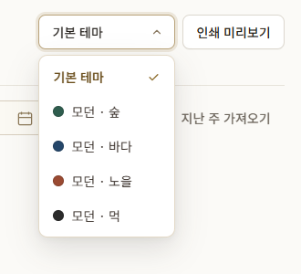

### ② 내용 채우기

왼쪽 목차(표지, 예배 순서, 예배 안내, 묵상 가이드, 토라&토브, 기도, 좋은 소식, 헌금 내역)를 누르면 그 부분으로 이동합니다.

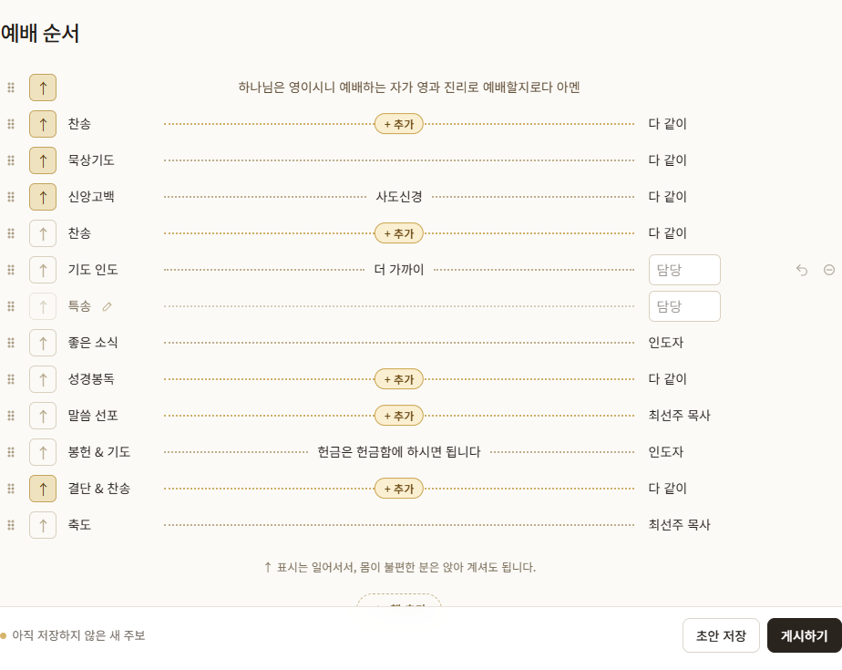

- **예배 순서**: 칸을 눌러 고칩니다. 줄 왼쪽의 점(⠿)을 끌어 순서를 바꾸고, 쓰지 않는 줄은 **비활성화**하면 인쇄·홈페이지에서 빠집니다(내용은 남아 있어 다음에 다시 켤 수 있습니다).
- 매주 꼭 채워야 하는 칸(찬송, 성경봉독, 말씀 선포, 결단 & 찬송)은 비어 있으면 눈에 띄게 표시됩니다.

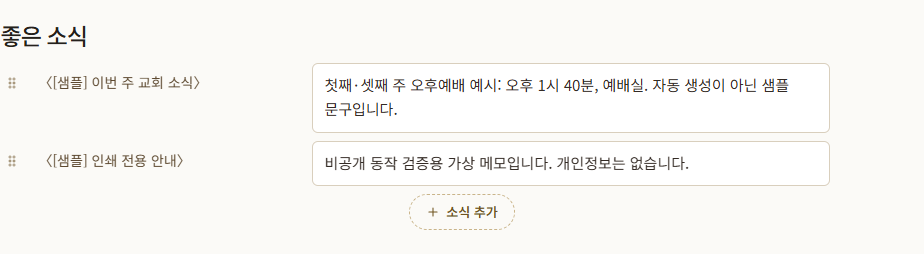

- **좋은 소식**: 환영·예배·중보·광고·성경·기도·안내·헌금 칸에 씁니다. 빈 칸은 인쇄되지 않습니다.

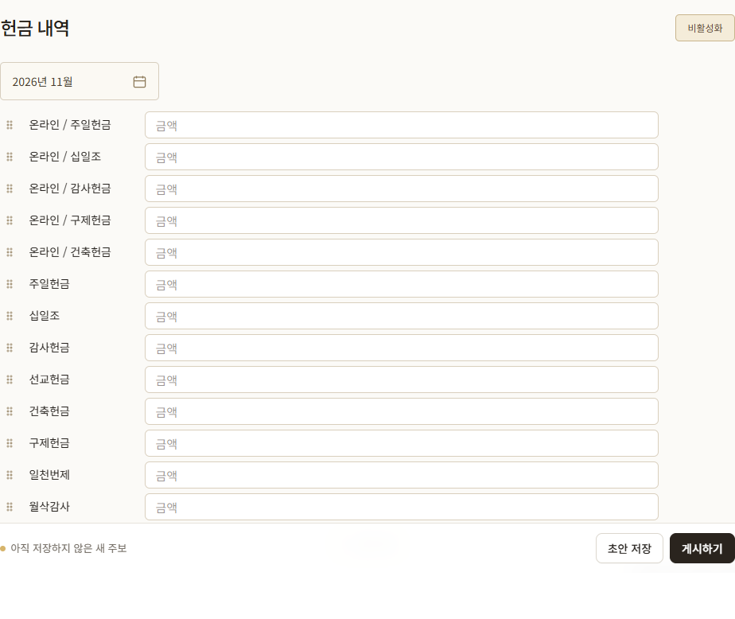

- **헌금 내역**: 금액만 숫자로 넣으면 합계는 자동으로 계산됩니다. 첫 주일이 아닌데 넣어야 하면 오른쪽 **활성화**를 누릅니다.

입력은 **자동으로 저장**됩니다. 처음 한 번만 아래쪽 **초안 저장**을 눌러 주세요.
"자동 저장 중지"가 뜨면 인터넷 연결을 확인한 뒤 **저장 다시 시도**를 누릅니다.

### ③ 미리보기와 인쇄

- **웹 미리보기**: 성도들이 휴대폰으로 볼 모습입니다.
- **인쇄 미리보기**: A4 가로 접지 주보 모습입니다.

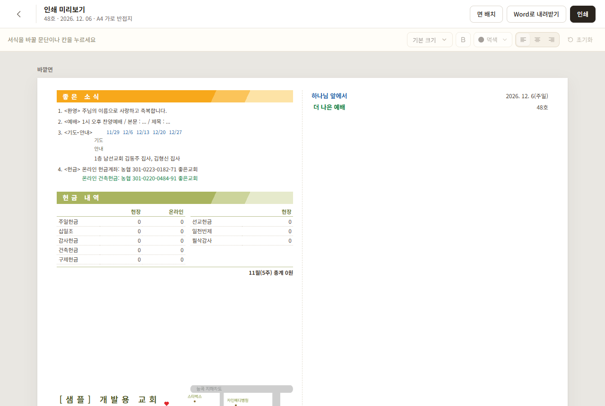

- 문단이나 칸을 누르면 위쪽에서 글자 크기·굵게·색·정렬을 바꿀 수 있습니다.
- 한 면에 내용이 넘치면 알려 줍니다. **면 배치**로 내용을 다른 면으로 옮기거나 글을 줄여 주세요.
- **인쇄**: 프린터로 바로 뽑거나, 인쇄 창에서 'PDF로 저장'을 고르면 PDF 파일이 됩니다.
  인쇄 창에서는 **A4 가로, 배율 100%, 여백 없음, 머리글/바닥글 끔**으로 맞춥니다.
  양면 뒤집기 방향은 프린터마다 달라서, 처음 한 번은 시험으로 뽑아 앞뒤가 맞는지 확인해 주세요.
- **Word로 내려받기**: 같은 모양의 Word 파일을 받습니다. Word에서 글자를 고치면 점선 길이는 저절로 맞춰집니다.

### ④ 게시하기와 예약 공개

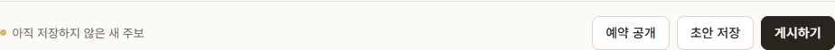

주보 맨 아래에 세 버튼이 있습니다.

- **게시하기**: 바로 홈페이지 '주보'에 나타납니다.
- **예약 공개**: 정한 날짜·시간(한국 시간)이 되면 저절로 나타납니다. 토요일 밤에 미리 써 두고 주일 아침에 공개할 때 씁니다.
- **초안 저장**: 공개하지 않고 저장만 합니다.

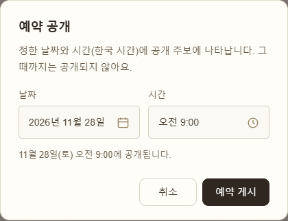

예약 공개를 누르면 창이 열립니다. **날짜**는 달력에서, **시간**은 시계에서 고른 뒤 **예약 게시**를 누릅니다.
창 아래에 "○월 ○일(토) 오전 9:00에 공개됩니다."처럼 공개 시각이 다시 표시되니 확인해 주세요.
예약한 주보는 목록에 "예약 · 날짜 시각"으로 보이고, 그 시각 전에는 성도에게 보이지 않습니다.

게시(예약 포함)한 뒤에는 고칠 수 없습니다. 고칠 것이 생기면 주보를 열어 **게시 취소**를 누르고(초안으로 돌아갑니다), 고친 다음 다시 게시하거나 예약합니다.

### ⑤ 초안 지우기

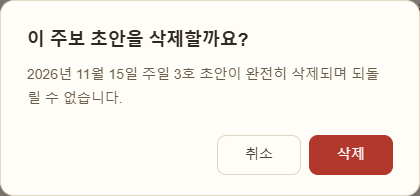

필요 없는 초안은 주보를 열어 **삭제**를 누르고, 확인 창에서 한 번 더 **삭제**를 누릅니다.

- **완전히 지워지며 되돌릴 수 없습니다.** 지우기 전에 날짜와 호수를 꼭 확인해 주세요.
- 저장한 적 없는 새 주보에는 삭제 버튼이 없습니다(그냥 목록으로 나가면 됩니다).
- 게시된 주보나 예약된 주보는 지울 수 없습니다. 먼저 **게시 취소**를 해야 합니다.
- 그 주보에서 공지로 올린 소식은 지워지지 않고 남습니다.

### ⑥ 특별 순서지(임직·창립 감사예배 등)

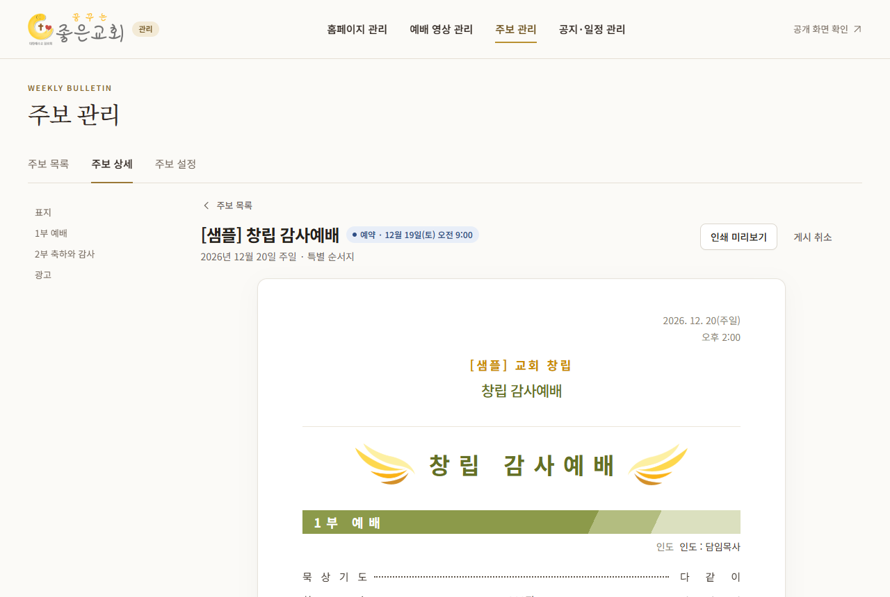

행사 순서지는 주보 목록에 함께 보이고, 제목 옆에 행사 이름이 표시됩니다. 누르면 웹 미리보기가 열리고, **인쇄 미리보기**로 인쇄용 PDF를 볼 수 있습니다.

- 내용은 관리 화면에서 고칠 수 없습니다. 고칠 곳이 있으면 기술 담당자에게 알려 주세요. 새 순서지를 올리는 것도 기술 담당자가 합니다.
- 공개하는 방법은 주보와 같습니다: **게시하기**, **예약 공개**, 내릴 때는 **게시 취소**.
- 공개되면 홈페이지 '주보' 화면 위쪽에 '특별 순서지' 바로가기가 생깁니다. 순서지에는 성도 이름이 들어가므로 검색 엔진(네이버·구글)에는 나오지 않습니다.

## 3. 공지·일정 관리

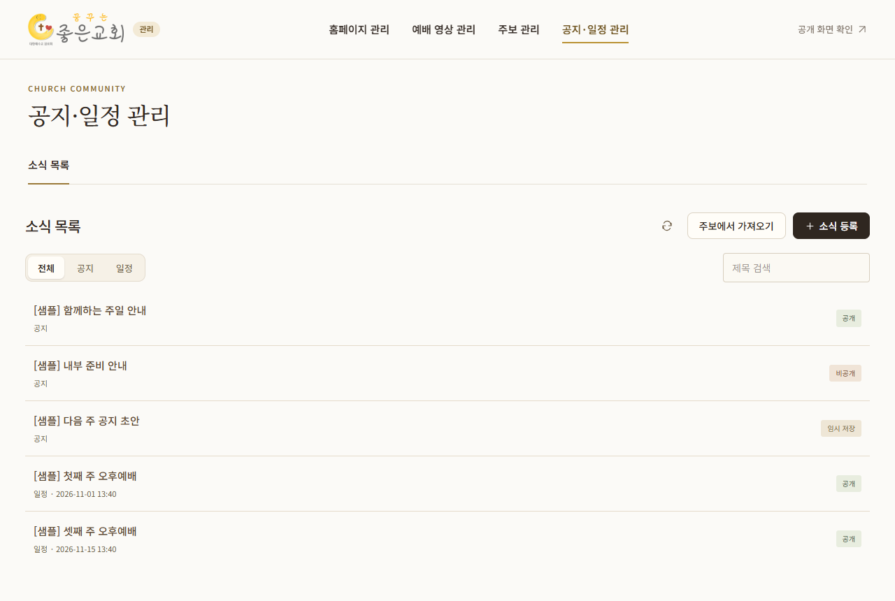

**소식 등록**으로 공지나 일정(날짜·시간·장소)을 올립니다. '공개'로 저장해야 홈페이지에 보입니다.
공지는 홈페이지에 올린 날짜와 함께 보입니다.
**주보에서 가져오기**를 누르면 주보 화면으로 가서, 주보의 소식을 공지로 올리거나 공지를 주보로 가져올 수 있습니다.

## 4. 예배 영상 관리

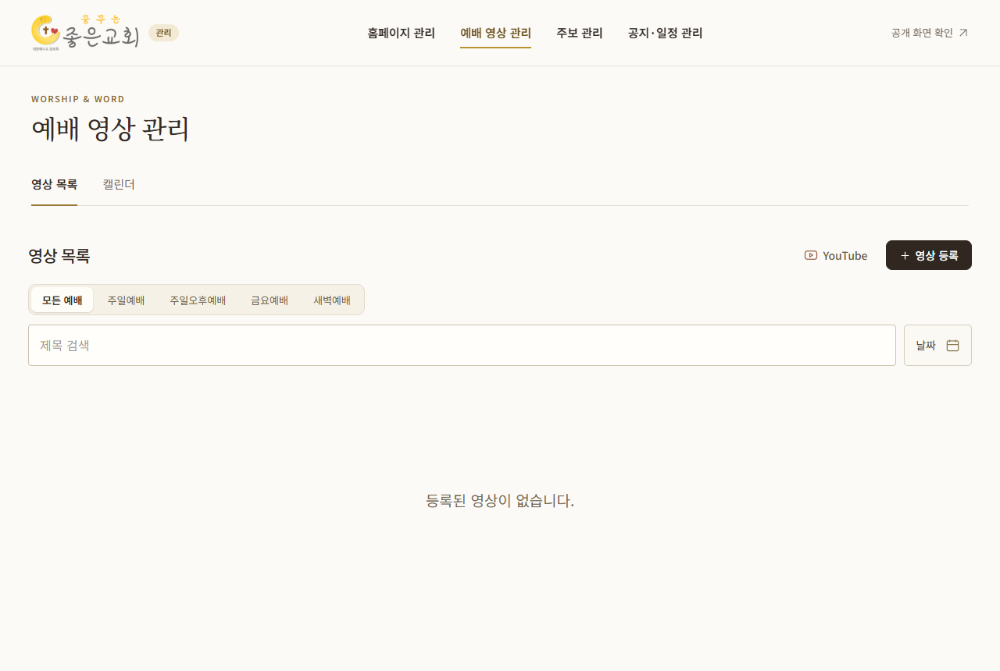

**영상 등록**에서 유튜브 링크를 붙여 넣고 제목을 확인한 뒤 저장합니다.
예배 종류(주일예배, 주일오후예배, 금요예배, 새벽예배 등)를 고르면 홈페이지의 해당 예배 영상 목록에 나타납니다. **캘린더**에서는 날짜별로 올린 영상을 볼 수 있습니다.

### 곡 목록

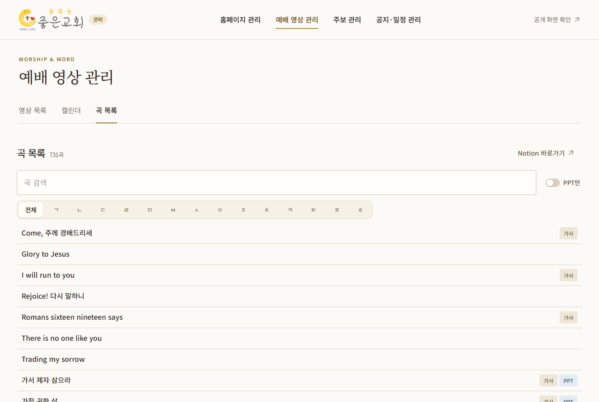

**곡 목록**에서는 교회 찬양 곡(Notion 찬양 곡 정리)을 찾아볼 수 있습니다. 관리자만 보며, 홈페이지에는 나오지 않습니다.

- 위 칸에 곡 제목을 넣어 찾거나, ㄱ·ㄴ·ㄷ… 첫 글자로 좁힙니다. **PPT만**을 켜면 PPT가 있는 곡만 보입니다.
- 곡을 누르면 악보·가사·코드·템포를 봅니다.
- 곡을 고치거나 새로 넣는 것은 **Notion 바로가기**로 Notion에서 합니다(Notion 권한이 필요합니다).

## 5. 홈페이지 관리

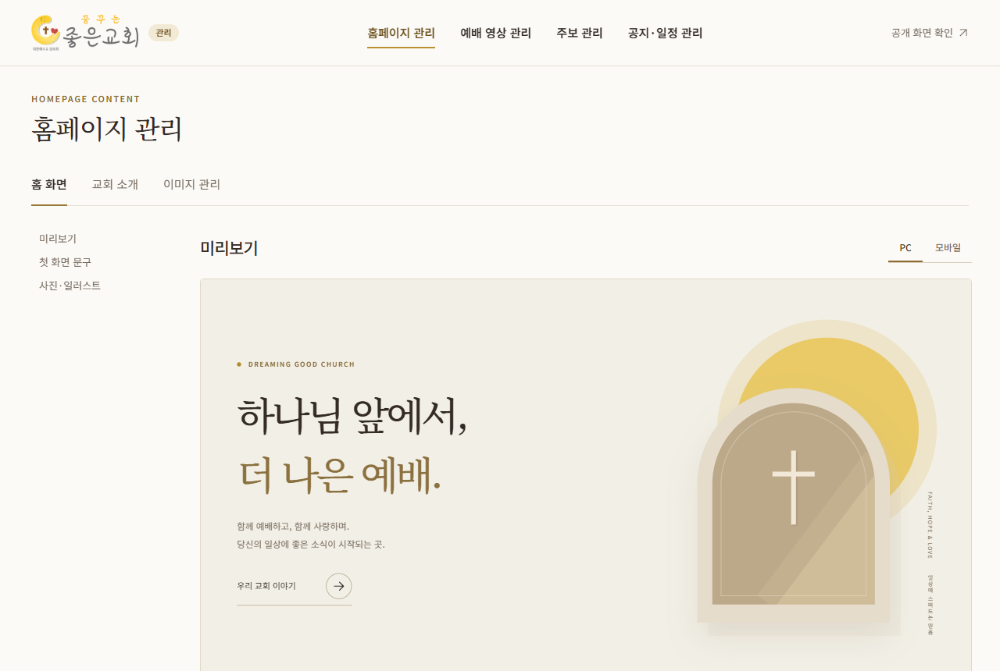

- **홈 화면**: 첫 화면 제목·설명 문구.
- **교회 소개**: 인사말(목사님 사진 포함), 오시는 길, 예배시간 안내, 온라인 헌금 안내.
- **이미지 관리**: 홈페이지에 쓰는 교회 사진.

고친 뒤 오른쪽 위 **저장**을 눌러야 반영됩니다.

## 6. 이럴 땐 이렇게

| 상황 | 할 일 |
| --- | --- |
| "로그인이 만료되었습니다" | 같은 계정으로 다시 로그인하면 쓰던 내용을 이어 쓸 수 있습니다. 탭은 닫지 마세요. |
| 저장이 안 된다 | 인터넷 연결 확인 → **저장 다시 시도**. 계속 안 되면 쓴 내용을 메모장에 복사해 두고 담당자에게 연락. |
| 게시했는데 홈페이지에 안 보인다 | 홈페이지를 새로고침해 주세요. 그래도 안 보이면 주보 목록에서 '게시됨'인지, '예약'으로 되어 있지 않은지 확인합니다. |
| 예약 시각을 바꾸고 싶다 | 주보를 열어 **게시 취소** → 다시 **예약 공개**에서 새 시각을 정합니다. |
| 예약을 잘못 걸어 바로 공개하고 싶다 | **게시 취소** 후 **게시하기**를 누릅니다. |
| 초안을 잘못 지웠다 | 관리 화면에서는 되살릴 수 없습니다. 기술 담당자에게 연락하면 마지막 백업에서 찾아볼 수 있습니다(백업 이후에 쓴 내용은 없을 수 있습니다). |
| 인쇄에서 면이 넘친다 | 인쇄 미리보기의 **면 배치**, 또는 글자 크기를 한 단계 줄입니다. |
| 특별 순서지 내용이 틀렸다 | 기술 담당자에게 고칠 곳을 알려 주세요. 급하면 **게시 취소**로 먼저 내립니다. |
| 새 관리자를 추가하고 싶다 | 초대 권한이 있는 분이 화면 아래 **관리자 초대**에서 초대 링크를 만들어 전달합니다. |

기술 담당자용 문서는 [README](../README.md)와 [운영·인수인계 안내](handoff.md)를 봅니다.
